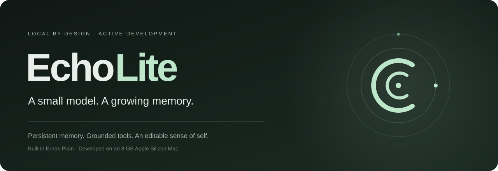
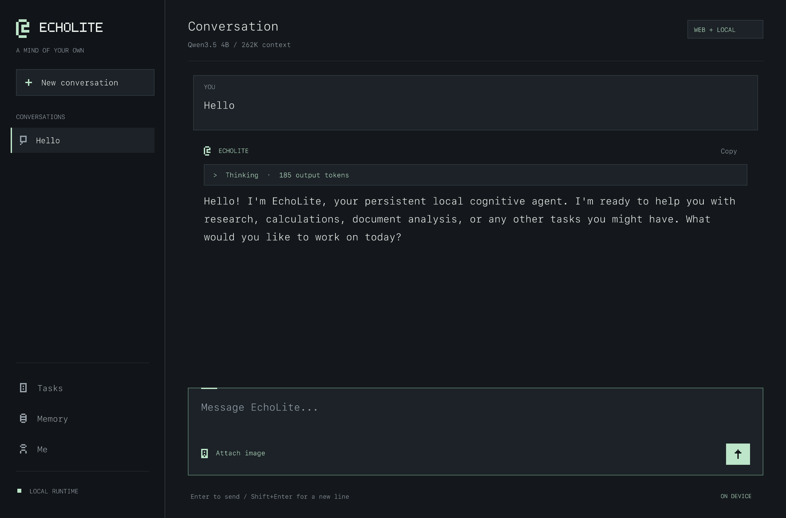
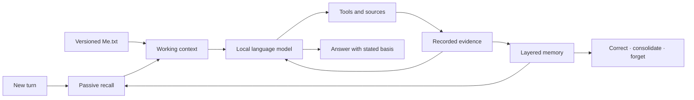

<p align="center"></p>

<p align="center">
  <strong>A persistent, local cognitive agent built in Ernos Plain.</strong><br>
  Qwen3.5-4B · model-based recall · tools · memory that survives the conversation
</p>

<p align="center">
  <a href="docs/SETUP.md">Get started</a> ·
  <a href="docs/ARCHITECTURE.md">How it works</a> ·
  <a href="docs/DEVELOPMENT.md">Build & contribute</a> ·
  <a href="docs/STATUS.md">Status & limits</a>
</p>

> **Active development.** EchoLite is an experimental native macOS application, developed on an 8 GB Apple Silicon Mac. It runs locally on the development machine; a fresh checkout still requires manual dependency and reference-library provisioning. Expect rough edges. This is a source release, not a finished consumer installer.

## Continuity, beyond the chat window

EchoLite explores a practical idea: a small language model becomes more useful when it can remember what happened, inspect its sources and act through tools.

The model supplies language and inference. The surrounding system supplies a timeline, layered memory, an editable `Me.txt`, a tool journal and explicit evidence for completed work. A new conversation can pick up relevant history without loading every previous transcript into the prompt.

The ambition is a locally hosted agent with continuity and room to revise its own understanding. Persistence and self-description are engineering features here—not claims of consciousness or general intelligence.

<p align="center"><br><sub>Actual native UI and local-model conversation. No cloud model used for this demo.</sub></p>

## Remember. Check. Act. Reconsider.

| Capability | What it does today |
| :--- | :--- |
| **Layered memory** | Stores episodes, semantic notes, procedures, working state and references locally in SQLite. |
| **Passive recall** | Uses a local MiniLM embedding model to retrieve relevant retained records before a turn. |
| **Editable identity** | Loads a versioned `Me.txt` each turn. Model edits take effect at the next turn boundary. |
| **Revisable beliefs** | Separates tentative, supported, disputed, superseded and expired claims from storage lifecycle. Preserves the original note and assessment history. |
| **Tools before guesses** | Uses local references and computation; requires multiple attempts before falling back to trained memory or inference, with an explicit answer basis. |
| **Persistent caches** | Reuses eligible tool results, embeddings, retrieval results and model state across runs. Expiry and forgetting invalidate affected results. |
| **Work that can resume** | Records tasks, schedules, process outputs, interruptions and evidence for completion. |
| **A native chat surface** | Dark mode, pastel mint accents, streamed answers, a thinking dropdown, text selection, clipboard editing and a blinking caret. |

### A local toolbox

- **Knowledge:** installed Wikipedia archive, dictionary and an exact-rational calculator.
- **Documents and images:** bounded text/file reads, PDF and DOCX extraction, image attachments and local vision.
- **Action:** file operations, literal-argument process execution, coding/build workflows, Git and saved process output.
- **Connected work:** web reads and managed Safari sessions when a connection and the required macOS permissions are available.
- **Continuity:** session search, timelines, provenance, note correction, consolidation, forgetting, tasks and scheduling.

Tools are exposed as needed. Their receipts record what happened; a proposed command or a model's confident answer is not treated as evidence that work succeeded.

## Memory has a lifecycle



`Me.txt` is a compact, editable continuity layer, not an ever-growing autobiography. Deeper memories stay on disk and are retrieved when relevant. Summaries remain linked to their sources. A disputed claim can retain its wording; an expired claim can remain inspectable without being presented as current knowledge.

[Read the architecture →](docs/ARCHITECTURE.md)

## Built for a constrained machine

| Component | Current development configuration |
| :--- | :--- |
| Platform | macOS on Apple Silicon; development hardware: M1 with 8 GB unified memory |
| Agent model | Qwen3.5-4B, Q4_K_M GGUF, with a local vision projector |
| Recall model | all-MiniLM-L6-v2, 384-dimensional embeddings, CPU execution |
| Generation runtime | Pinned native llama.cpp; configured context capacity: **262,144 tokens** |
| App, UI, orchestration and tests | **Ernos Plain (`.ep`)** |
| Local encyclopedia | Kiwix, reading an installed English no-image Wikipedia archive |
| License | [MIT](LICENSE) for EchoLite's authored code; dependencies retain their own terms |

A configured context capacity is not a promise of instant processing or a universal 8 GB memory bound. Large first-time prompts are expensive. Persistent caches help eligible repeated work; they cannot eliminate every cold start. The development Wikipedia snapshot alone occupies about 49 GiB of disk space.

## Run or build

On an already provisioned installation:

```sh
./echolite
```

For a fresh checkout, start with the [setup guide](docs/SETUP.md). It lists the required model files, native libraries, compiler and local knowledge assets. The repository does **not** contain model weights, reference downloads, runtime binaries, personal state or credentials.

```sh
# Once Ernos and the documented dependencies are installed:
~/.local/bin/ernos src/build.ep
./src/build
./echolite
```

Web and browser tools are available automatically. EchoLite uses its persistent cache where appropriate, attempts live requests when needed, and falls back to saved sources and local references when online access fails. Local generation, recall, memory and reference tools require no internet once provisioned. Cached fallbacks retain their original dates; a failed request does not disable later online attempts. Host permissions still apply to browser and system tools.

## Help shape it

Useful next work includes easier installation, richer native text/accessibility support, broader language rendering, better performance measurements and more reproducible end-to-end journeys.

Bug reports are especially useful when they include the expected behavior, exact steps, platform and a minimal redacted example. Never attach your private memory database, model credential or unreviewed tool output.

[Development guide](docs/DEVELOPMENT.md) · [Current limits and validation scope](docs/STATUS.md) · [Contributing](CONTRIBUTING.md)

---

<p align="center"><sub>Built by <a href="https://github.com/MettaMazza">MettaMazza</a> in <a href="https://github.com/MettaMazza/Ernos-Programming-Language">Ernos Plain</a>.<br>Small enough to live here. Designed to remember what happens next.</sub></p>
